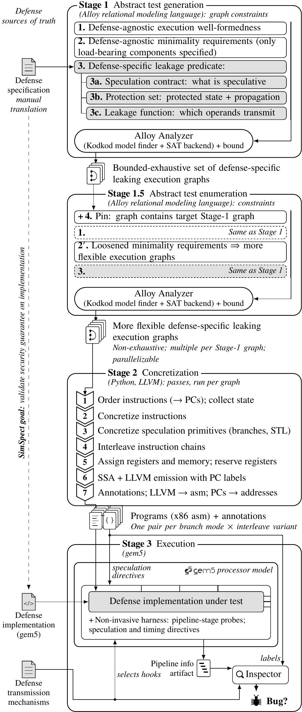
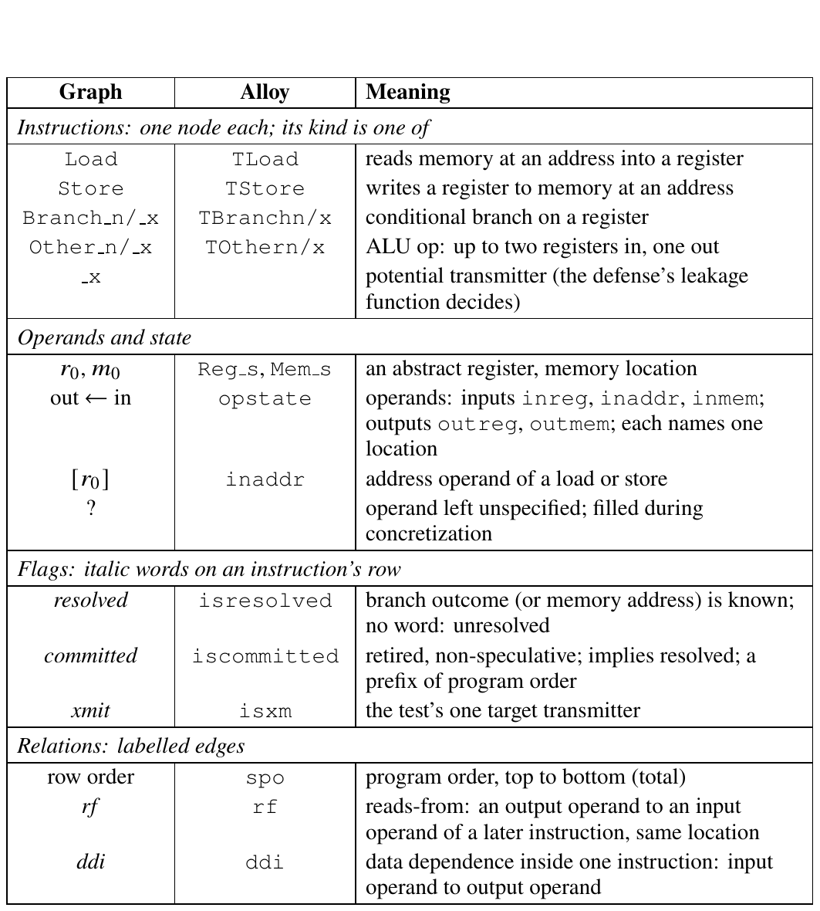
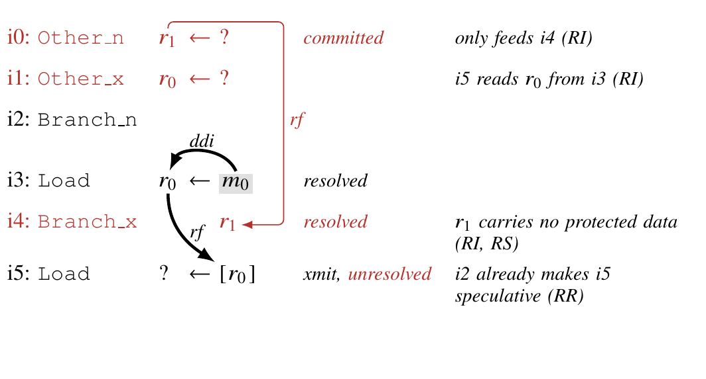
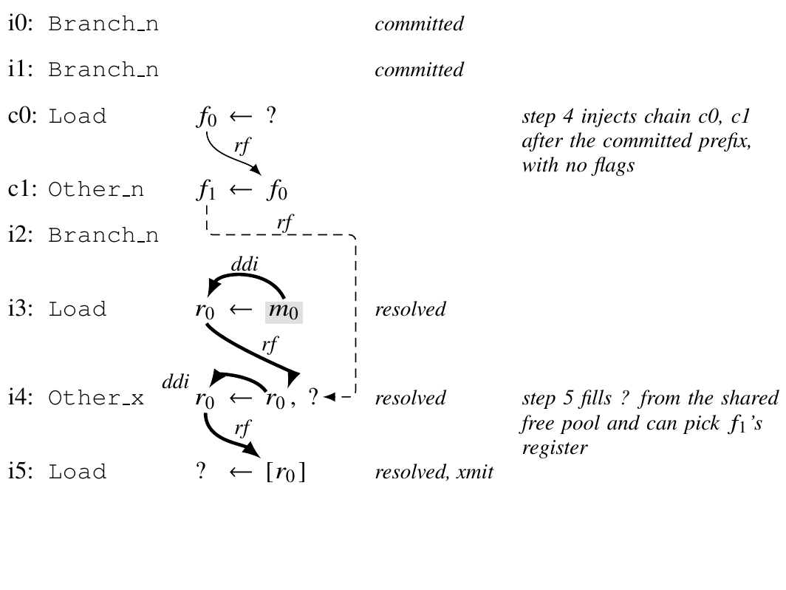
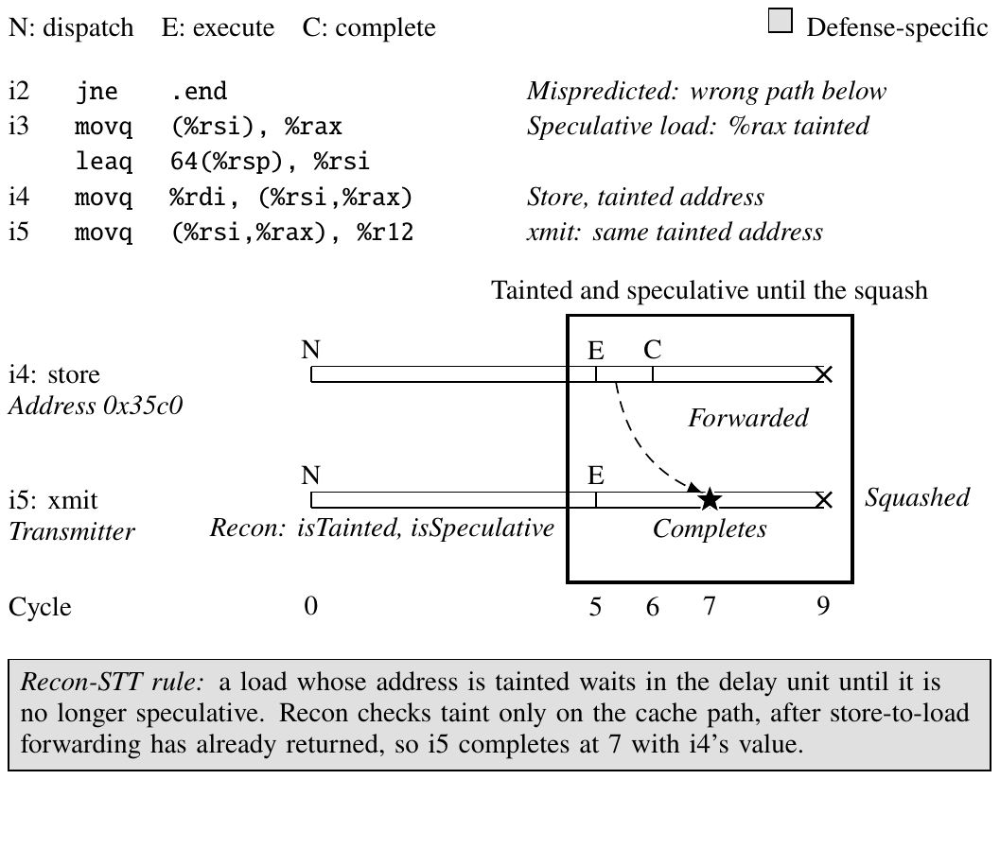
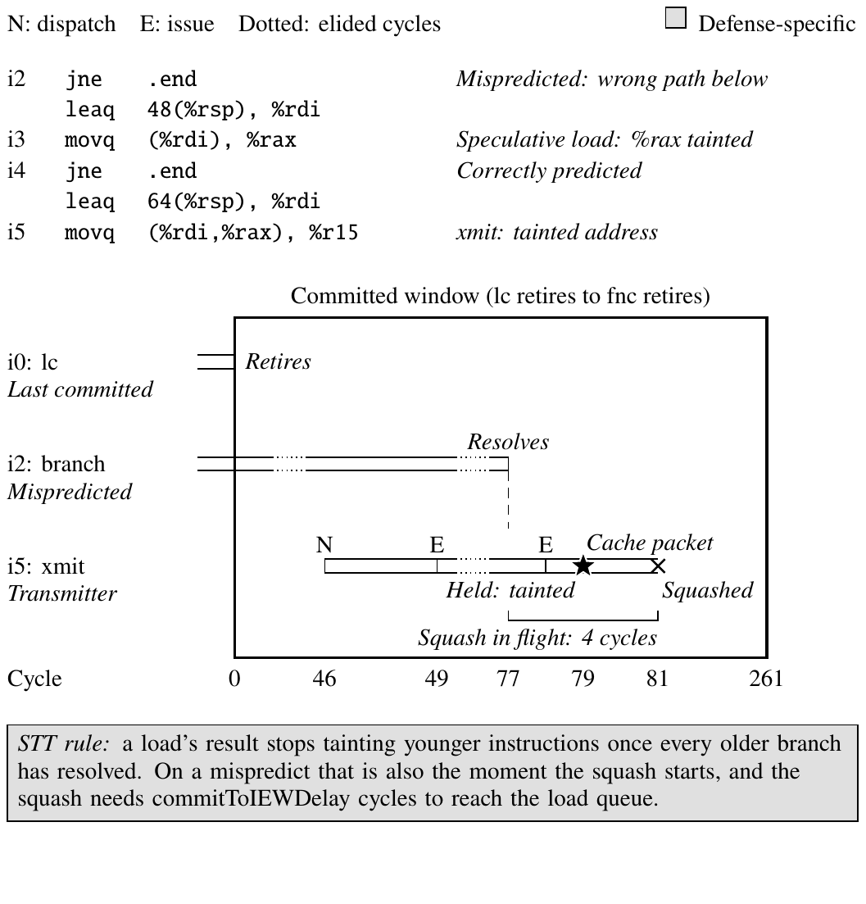
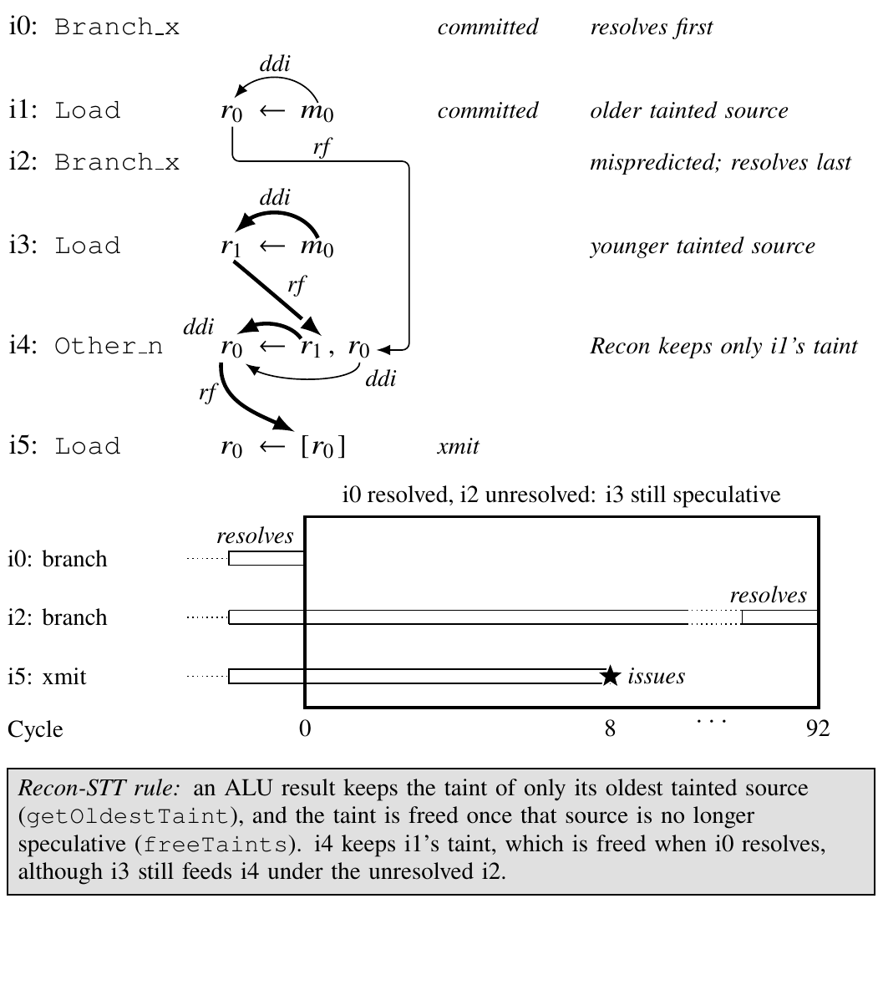
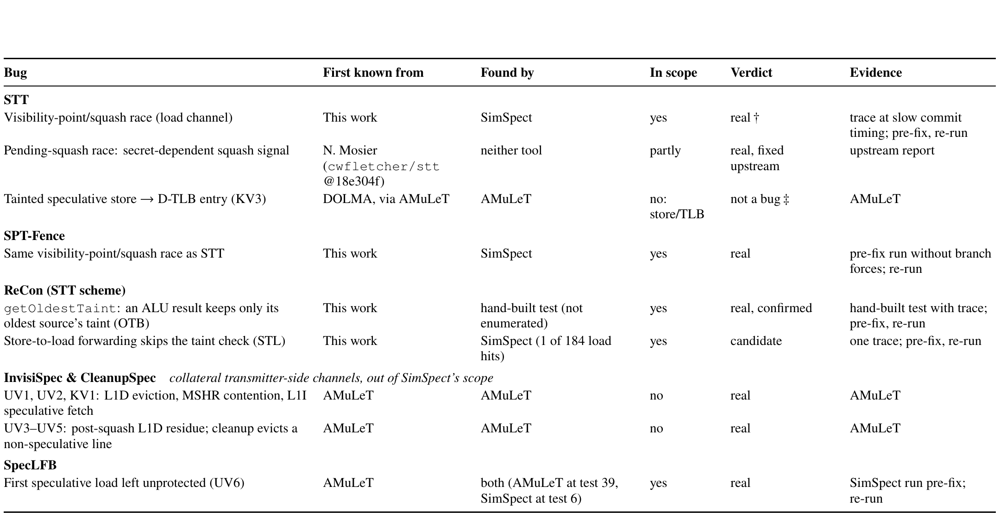

# Paper figures: all current drafts

One page with every draft. Sources (`_standalone_*.tex`) and previews (`*-1.png`) live in [`drafts/`](drafts/). Previews show the figure only, with blank space where the caption will go; the proposed captions are in the **Captions** section at the bottom, for Anna to edit and paste into each `\caption{}`. Plans, citations and open decisions per figure are in [`plans/`](plans/); the shared style is [`plans/VISUAL_LANGUAGE.md`](plans/VISUAL_LANGUAGE.md); the audit of every figure already in the paper is [`plans/AUDIT_existing_figures.md`](plans/AUDIT_existing_figures.md). Updated 2026-11-02.

## Which figure replaces what (proposal; Anna decides)

| Draft | Replaces in the paper (`test-paper`) | Status |
|---|---|---|
| Pipeline (vertical) | `tikz/threelayer.tex` (intro, Fig 1: wider than the column, 5pt text, never referenced) | draft; shape redesign in progress |
| (a) Execution-graph vocabulary table (`execvocab`) | nothing (syntax is prose only at `sections/pipeline.tex:9`) | new; vocab table |
| (b) Relaxation (`relaxation_v4`) | `tikz/relaxation.tex` (Fig 3), and possibly `tikz/alloyviolation.tex` (Fig 2) if merged | v4 draft, shared graph notation |
| (c) Interleave (`interleave_v4`) | `tikz/interleave.tex` | v4 draft: the Stage 2 round |
| (d) Instrumentation table | `tikz/sptable_v2.tex` / `sptable.tex` and `tikz/resolutiontiming_v2.tex` / `resolutiontiming.tex` | v2 draft, one column |
| (e) Checker window | `tikz/checkerwindow.tex` | v4 draft |
| (f) Transmission criteria | nothing (new) | draft, full width |
| (not redone yet) | `tikz/statetable.tex`, `tikz/squashrace.tex` (results) | keep; restyle per the audit |

## Pipeline (CURRENT, in the paper as tikz/pipeline_full.tex: text-rich direction A v2, 251 × 620 pt)

Previous main version (still in drafts): `drafts/_standalone_pipeline_vertical-1.png`; text-rich A v1: `drafts/design_mocks/mock_A_full-1.png`.

Rejected earlier versions (no left column) are in `drafts/old/`. A shape-language redesign (how to make components meaningfully shaped instead of walls of text) is being drafted by an agent: `plans/BIGFIG_SHAPE_DESIGN.md` + `drafts/design_mocks/` when done; a fact audit of every label: `plans/BIGFIG_FACT_AUDIT.md` when done.

## Pipeline: shape-language redesign mocks (for comparison; Anna picks)

Brief and shape vocabulary: [`plans/BIGFIG_SHAPE_DESIGN.md`](plans/BIGFIG_SHAPE_DESIGN.md). The mocks predate the latest wording edits (e.g. "on implementation", "processor model", "parallelizable", the language lines), which carry over to whichever direction is chosen.

**A: shape-coded blobs** (agent's recommendation; 252 × 375 pt)

**B: one spine** (252 × 415 pt)

**C: merged Alloy stage** (252 × 345 pt)

## (a) Execution-graph vocabulary table

`execvocab`: 251 × 257 pt, one column, TransForm Table I style. The old boxes-and-dots draft is `drafts/_standalone_execgraphsyntax-1.png`.

**2026-11-02 v4 (current; v3 Alloy-first rejected):** `drafts/execvocab_v4_8pt.tex`, preview `drafts/_standalone_execvocab_v4_8pt-1.png`. One row per section (Instructions, Booleans, Operands, State, Relations), 252 × 108pt. Details in `plans/fig_a_execgraphsyntax.md`.

## (b) Relaxation

v4: 251 × 111 pt, in the shared graph notation (`plans/VISUAL_LANGUAGE.md`, "Graph notation"). v3 is `drafts/_standalone_relaxation_v3-1.png`.

## (c) Interleave: the Stage 2 round

v4: 251 × 165 pt. The base rows are a real forced-shape STT_6 instance; c0 and c1 are the injected chain (see `plans/fig_c_interleave.md`, 2026-11-02 section). v3 is `drafts/_standalone_interleave_v3-1.png`.

## (d) Instrumentation table

v2: one column, 251 × 189 pt (v1, full width, is `drafts/_standalone_instrtable-1.png`).

## (e) Checker window

v4: 251 × 179 pt (v3 is `drafts/_standalone_checkerwindow_v3-1.png`).

## (f) Load-transmitter transmission criteria per defense (full width, new)

## Reference: how Caroline Trippel's papers draw these things

13 papers and 17 figure crops in [`reference_papers/crops/`](reference_papers/crops/); conventions with page cites in [`plans/TRIPPEL_FIGURE_STYLE.md`](plans/TRIPPEL_FIGURE_STYLE.md).

## Captions (proposed; Anna edits and pastes into `\caption{}`)

**Pipeline.** The \toolname{} pipeline. Stage~1 uses Alloy to enumerate, exhaustively up to a bound, minimal abstract execution graphs that satisfy a defense's leak definition, which is translated manually from the defense specification into the \toolname{} DSL. Stage~1.5 re-enumerates with loosened minimality, pinned to each Stage-1 graph, to reach more complex graphs. Stage~2 concretizes each graph into x86 programs with annotations, one per branch mode and interleave variant. Stage~3 runs each program on the defense's gem5 build under a harness that applies speculation and timing directives; an inspection program checks the pipeline trace for the defense's transmission criteria inside the speculative window. Gray marks defense-specific parts and sources of truth. *("Bounded exhaustive" holds once Stage 1 runs to completion at the bound; see `URGENT_TODO.md`.)*

**(a) Execution-graph vocabulary table (`execvocab`).** \textbf{Execution-graph vocabulary shared by every SimSpect defense model.} An execution is a graph: instruction nodes in program order whose operands name abstract locations, three Boolean flags per instruction, and two operand-to-operand relations. \emph{Graph}: how Figs.~X and~Y draw each element; \emph{Alloy}: its name in the model. Only the defense block (speculation contract, protection set, leakage function) differs between models.

**(b) Relaxation (v4).** \textbf{A violating STT execution before minimization (enumerated instance inst-047231).} Each row is one instruction in program order: its id, its kind, its operands written output $\leftarrow$ input ($[\,]$: an address, ?: left unspecified), and its flags as italic words (a branch without \textit{resolved} is unresolved; \textit{xmit} marks the target transmitter). Arrows are labelled rf (reads-from, between instructions) and ddi (data-dependence internal); vocabulary in Table~X. Black is the violation: protected memory $m_0$ (gray: STT protects all memory) flows through i3 into the address of transmitter i5 (thick arrows), and i5 is speculative because branch i2 is unresolved. Red marks what the relaxations remove while the execution still violates: instructions i0, i1 and i4 (RI), the state $r_1$ (RS), and i5's unresolved flag (RR). Minimization deletes them, leaving the three-instruction backbone i2, i3, i5.

**(c) Interleave (v4).** \textbf{Stage~2 interleaving makes a two-source merge that no Stage~1 instance contains.} Rows i0--i5 are an STT Alloy instance, in the notation of Table~X: protected $m_0$ (gray) flows through i3 and the ALU op i4 into the address of transmitter i5 (thick arrows), and i3--i5 are speculative because branch i2 is unresolved. i4's second input is left unspecified (?). Concretization step~4 (interleave) injects a chain of synthetic instructions, here c0 (a load) and c1 (an ALU op), at random positions after the committed prefix; chain steps carry no flags, and their outputs $f_0$, $f_1$ take registers from a free pool. Step~5 (register assignment) fills every unspecified operand from the same pool, so i4's ? can receive $f_1$'s register, which creates the dashed rf edge: i4 now merges c0's value, which is speculative only under the older branches i0 and i1, with i3's value, which stays speculative under i2. This is the shape behind the ReCon \texttt{getOldestTaint} bug: ReCon keeps only the oldest taint source of an ALU result, so once c0's speculation resolves it untaints i4's result even though i3's value ($r_0$) should still be protected, and i5 transmits.

**(d) Instrumentation table (v2).** \textbf{How concretization instruments each execution-graph element.} Rows are graph fragments in the notation of Fig.~X (xmit: the test's one target transmitter; lc, fnc: last committed, first non-committed). Stage~2 also annotates each element's PC, each branch's mode and predicted target, and the xmit's kind; Stage~3 uses the annotation and marks a run invalid if a force or hold did not take effect. Every instruction is an inline-asm block with a global PC label, after a prologue that zeroes state and runs \texttt{mfence}; no other instruction is hooked. Not generated: correctly predicted unresolved branches, taken resolved branches. *(Agent suggests moving the last two sentences into the text.)*

**(e) Checker window (v4).** \textbf{How the checker decides a violation, on a real gem5 trace} (InvisiSpec build, test inst-002014). Each bar is one instruction from fetch (F) through decode (D) and issue (E) to retirement; dotted stretches are elided cycles. The roles lc (last committed), fnc (first non-committed, here the unresolved branch) and xmit (transmitter) are labels carried from the Alloy instance, and the unresolved window runs from lc's retirement to the branch's resolution. Inside that window the checker applies the defense's transmission criterion (gray): xmit's L1D eviction ($\star$) meets InvisiSpec's criterion before xmit is squashed, so the test is reported as a violation.

**(f) Transmission criteria.** \textbf{Load-transmitter transmission criteria per defense.} For each defense build, what the Stage~3 inspection program counts as a load transmitting, what it deliberately ignores, and which trace line it reads. InvisiSpec, SpecLFB and CleanupSpec each have a defense-specific criterion (gray), stated over \toolname{}'s cache-event hook lines and scoped to the structures the defense's paper protects. STT-Spectre and Recon-STT have no such criterion and use the generic load gate.

## Results figures (2026-11-02)

Evidence, per-figure verdicts, pre/post-harness-fix status, other bug candidates, decisions (R1–R4) and suggested paper text: [`plans/RESULTS_FIGURES.md`](plans/RESULTS_FIGURES.md). Bug-example figures first (Anna); `bugtable_v2` and `targeteff_v2` are not drawn yet.

**Recon STL bypass (`reconstl_v2`, real trace inst-014912, 250 × 220 pt; would replace `tikz/reconstl.tex`)**

*Proposed caption* (`drafts/captions/reconstl_v2.tex`): \textbf{Recon-STT lets a tainted load complete through store-to-load forwarding} (gem5-recon-modded, STT scheme, test inst-014912). Top: the wrong-path fragment; i3 loads speculatively, so \%rax and every address built from it are tainted, and the store i4 and the transmitter i5 use the same tainted address. Bottom: the two instructions in the gem5 trace (cycle = (tick $-$ 2679000)/500). At cycle 5 Recon's own check reports i5 tainted and speculative, yet i5 takes i4's value from the store queue and completes at cycle 7 ($\star$), before the squash at 9. STT requires a tainted-address load, and the forwarding decision itself, to wait until the address is untainted (STT, Sec.~6.4.2, 6.5). In Recon the taint check sits only on the cache path, after the forwarding path has returned (gray).

**Visibility-point/squash race (`squashrace_v2`, real trace inst-047231, 250 × 265 pt; would replace `fig:trace` and `tikz/squashrace.tex`)**

*Proposed caption* (`drafts/captions/squashrace_v2.tex`): \textbf{The visibility-point/squash race in STT, on a real gem5 trace} (STT build with commitToIEWDelay $=4$, test inst-047231; flag-setting instructions omitted from the listing). The transmitter i5 is ready to issue at cycle 49 but is held because its address comes from the speculative load i3. At cycle 77 the mispredicted branch i2 resolves; STT immediately stops treating i3's result as tainted, and i5 issues at 78 and sends a cache packet at 79 ($\star$). The squash caused by the same resolution reaches the load queue only at 81. Cycle 0 is the retirement of the last committed instruction; the committed window closes when fnc retires at 261. At stock timing (commitToIEWDelay $=1$) the squash wins and no packet is sent. *(Window wording depends on decision R1.)*

**Recon OTB / getOldestTaint (`recon_otb_v2`, hand-built test, real pipeview ticks, 250 × 261 pt drawn; would replace `tikz/otbtwobranch.tex`, `fig:otb`)**

*Proposed caption* (`drafts/captions/recon_otb_v2.tex`): \textbf{Recon-STT releases a transmitter whose address still depends on a speculative load} (\texttt{getOldestTaint}; \texttt{/work/gem5-recon}, STT scheme, hand-built test). Top: the test as an execution graph in the notation of Table~X. The ALU op i4 merges $r_0$ from the older load i1, speculative under branch i0, with $r_1$ from the younger load i3, speculative under the mispredicted branch i2; its result is the address of transmitter i5 (thick arrows: the flow from i3). Bottom: the gem5 pipeline trace (cycle = (tick $-$ 2803000)/500). i0 resolves at cycle 0, and i5 issues at cycle 8 ($\star$), as soon as i4's result is ready and at the same cycle as with no defense, while i2 stays unresolved until cycle 92. Recon gives i4's result only the taint of its oldest tainted source and frees it when that source stops being speculative (gray), so the dependence on i3 is lost. This test was built by hand; our bounded enumeration does not reach this shape within its instance cap. *(The star marks issue only: the scheme-2 pipeview records no completion for the xmit; see `plans/RESULTS_FIGURES.md` §7.)*

**Bug table (`bugtable_v2`, full width `table*`, B&W, 514 × 236 pt; replaces `tab:bugs` in `results.tex:20-55`)**

*Proposed caption* (`drafts/captions/bugtable_v2.tex`): \textbf{Speculative-execution defense bugs, grouped by defense:} where each bug was first known, which tool exhibits it (\toolname{}, AMuLeT, both, or neither), whether it falls in \toolname{}'s leakage model, the verdict, and the evidence behind it. \emph{Pre-fix, re-run}: the evidence predates our 2026-10-30 fix of the branch-annotation and resolve-stall harness, and the run is being repeated. The ReCon \texttt{getOldestTaint} bug is confirmed by a hand-built test that our bounded enumeration does not reach; the ReCon store-to-load forwarding bug rests on one trace and remains a candidate. The pending-squash race (a secret-dependent squash signal, fixed upstream by Mosier) is a real STT bug that \emph{neither} automated tool found. The InvisiSpec and CleanupSpec rows are collateral transmitter-side channels, not logic bugs in a comprehensive defense, and lie outside \toolname{}'s scope. \textdagger\ A violation if the speculative window ends when the first non-committed instruction retires; not one if it ends when the guarding branch resolves. \textdaggerdbl\ Not a bug: STT's specification does not treat stores as transmitters, so a tainted-store$\to$TLB leak is outside the property STT claims to enforce.

## Suggested paper text (collected 2026-11-02; Claude never edits paper prose — Anna pastes)

- Interleave (c): the figure now shows Stage 2 interleaving; say so in the subsection text, and the old caption's reg0 should be reg1.
- Relaxation (b): `pipeline.tex:20` cites `fig:relaxation`; the new figure carries that label, so the reference resolves now.
- DSL: not used (Anna: DSL means domain-specific language; dropped).

### Vocab table (a)

Proposed prose trim (for Anna): if the figure goes in, the middle of `pipeline.tex:9` ("typed as transmitters … track information flow to transmitters.") can shrink to one sentence pointing at Fig.~\ref{fig:execsyntax}. That pays back roughly 4 lines of text.

### Instrumentation table (d): text moved out of the table

Source: `plans/fig_d_instrtable.md`.

Every instruction is emitted as its own inline-asm block that carries a global PC label, so nothing can sit between the label and the instruction; the annotation rewrites each label as an x86 address. A prologue zeroes the memory slots, the probe array (when used) and the live-in registers, then runs \texttt{mfence}. Address operands index the probe array, and the program is compiled with clang \texttt{-O2}. Stage~3 adds no hook for ordinary instructions: it reads transmission from gem5's O3PipeView, LSQUnit and Commit traces, with the checker chosen by the xmit's kind (Load, Store, Branch\_x, or Other\_x, a zero-skip multiply or a divide). Branch conditions are constants (\texttt{movq \$1} or \texttt{xorq}), and a Branch\_x that is not the xmit is handled like a Branch\_n. A branch xmit that is the last instruction is followed by a \texttt{nop}; divides other than the xmit get \texttt{orq \$1} on their divisor so they cannot fault. Store bypass is its own run mode, with all branches resolved, on a gem5 build with store-bypass hooks; when an address register is involved, the store is re-emitted at the load's runtime address. All values are those of the evaluated campaigns.

(Sources: Row 6 and Rows 1, 2, 5 bullets above.)

### Instrumentation table (d): where the paper text disagrees with the code

Source: `plans/fig_d_instrtable.md`.

1. `sections/pipeline.tex:46`: "For resolved branches … insert a skipped block of noops if they are taken". Code generates resolved branches only as correctly predicted not-taken (row 3).
2. `pipeline.tex:48` and `:86`: STL "only in the false positive direction … enforce that the load and store have different addresses". Code does the false-negative direction with the load and store at the same address (row 1; Anna's 2026-10-28 answer in SPEC_PRIMITIVE_INSTANCES.md "Open").
3. `pipeline.tex:86`: "runs are launched bare at $s_U = 0$" and "the commit-stall over {0, 150} cycles". The fixed configs use $s_U = 5000$ and commit stall 0 (rows 2, 4).
4. `pipeline.tex:86`: the BTB-forced target forces "the modeled mispredicted (taken) path". On hooked builds every annotated branch now gets a derived force in either direction, resolved branches included (rows 2, 3, 5).
5. `pipeline.tex:83`: the annotation carries "the resolution time of every speculation primitive". Stage 2 never writes timing; Stage 3 adds `resolve_stall_cycles` on the sweep path and the store hold comes from config (CONCRETIZATION_PASSES.md §4.3).
6. `pipeline.tex:57`: "all branches guarding the transmitter are still unresolved". The gate is the model's unresolved branches, measured at `resolve_visible` (row 2).
7. `pipeline.tex:88`: "the same nine source sites". The builds now also carry the resolve hooks (BR print lines, forced not-taken via target 1, release wakes the CPU) and, on gem5-recon-stl, the STL hooks.

Suggested caption (Anna pastes, if she wants it): "How concretization instruments each execution-graph element. Stage 2 emits the program and its annotation; the Stage 3 harness reads the annotation to force predictions, hold resolutions, and bound the window in which the target transmitter must transmit. Values are those of the evaluated campaigns."

### Transmission criteria (f): where the paper text disagrees

Source: `plans/fig_f_xmitcriteria.md`.

- `sections/pipeline.tex:63` describes the load signal as LSQUnit ticks "(… on newer builds an additive `memaccess` tick for SpecLFB and an `expose` tick for InvisiSpec)". Those are the legacy checkers (`check_ld_speclfb.py`, `check_ld_invisispec.py`); the JSON criteria use SimSpect cache-event hook lines instead.
- `pipeline.tex:55, 90` say detection reads only the existing `O3PipeView`, `LSQUnit` and `Commit` streams and that "No cache or defense code is instrumented to *see* a leak". The footprint criteria read SimSpect print hooks added to the cache code (`SIMSPECT_HOOKS.md`), and every row's window uses the BR resolve hook lines.
- `pipeline.tex:57`: "all branches guarding the transmitter are still unresolved". The gate is the model's unresolved branches, at `resolve_visible` (same note as fig d).

### Results section (Recon, race, caveats)

Source: `plans/RESULTS_FIGURES.md`.

**Recon (new paragraph).** We also ran SimSpect on ReCon's gem5 implementation of STT, which treats both unresolved branches and stores with unresolved addresses as sources of speculation. It exposes a bug in how ReCon applies STT's load rule: ReCon checks a load's taint only on its cache path, after store-to-load forwarding has already returned. A speculative load whose address is tainted therefore completes with a forwarded value whenever an in-flight store has the same address (Fig.~\ref{fig:reconstl}). STT names exactly this case an implicit branch and requires the forwarding decision to wait until the address is untainted, or the forwarded value to be written only when the memory access would have completed [STT, §6.4.2, §6.5]. The completion time of the load therefore reveals whether a secret-derived address matches a store address the attacker chose.

**Recon OTB (if kept).** ReCon's taint tracker also keeps only the oldest taint source when an instruction merges two tainted operands. When the older source's branch resolves, the result is untainted even though it still depends on a younger speculative load, and a dependent transmitter issues. We confirmed this with a hand-built two-branch test; our bounded enumeration does not reach this shape within its instance cap.

**Race (revised framing; depends on R1).** In STT, a transmitter's address stops being tainted the moment every older branch resolves. When that branch was mispredicted, the same event starts the squash, which reaches the load queue `commitToIEWDelay` cycles later. In inst-047231 the held transmitter issues one cycle after resolution and sends a cache packet two cycles before its squash (Fig.~\ref{fig:race}). At stock timing the squash wins.

**Caveat (pre-fix numbers).** The counts in this section (race instances, the stall and fragility sweeps, SpecLFB detection speed) come from campaigns run before we fixed the branch-annotation and resolve-stall harness on 2026-10-30; on the SPT and ReCon builds those campaigns ran without the intended forced mispredicts and stalls. We are re-running them; the two traces shown here do not depend on the fix, since their mispredictions occur naturally.

## 8pt-minimum versions (in the paper as of 2026-11-02)

Every figure in the paper now uses its `_8pt` version (all text at least 8pt, including arc labels); the 7pt versions are kept in `drafts/`. Previews: `drafts/_standalone_<name>_8pt-1.png` for intro_threelayer_v2, execvocab, relaxation_v4, interleave_v4, instrtable_v2, checkerwindow_v4, xmitcriteria, reconstl_v2, squashrace_v2, recon_otb_v2, bugtable_v2; pipeline: `drafts/design_mocks/mock_A_full_v2_8pt1col-1.png` (one column, in the paper next to the 7pt one; keep one) and `mock_A_full_v2_8pt-1.png` (double wide, not used).

## Defenses out of scope (proposed text) — 2026-11-02

Proposed paragraph (for Anna to edit and paste; not in the paper): We evaluate SimSpect on defenses whose authors released a gem5 implementation that we could build and instrument with our print-only hooks: STT, Recon, SPT, SpecLFB, InvisiSpec, and CleanupSpec, with Delay and DoM run as schemes of the Recon build. For InvisiSpec and CleanupSpec, the leaks SimSpect finds (the UV1 eviction channel and post-squash cleanup residue) lie outside the protection each paper claims, so we report them as collateral channels rather than as violations of the defense's own guarantee. We did not evaluate SDO: its public source is available, but we have not yet built it or added our hooks, so it is left for future work. [Placeholder: one sentence on the remaining defenses (NDA, SafeSpec, MuonTrap, DOLMA, SpecShield, ConTExT, Conditional Speculation, GhostMinion), once Anna has decided why each is excluded.]

- **InvisiSpec**: in the harness, but its findings are out of the defense's guarantee (collateral channels). Source: `specs/defense_units.json:29`, `wiki/findings/mdsToRead/PROTECTION_SCOPE_TABLE.md`.
- **CleanupSpec**: in the harness, but its findings are out of the defense's guarantee (post-squash residue, unXpec). Source: `specs/defense_units.json:33`.
- **SDO**: an implementation exists (`/work/sdo`, cwfletcher/sdo @ 5d058fd) but was never built or hooked. This is closest to "implementation exists but not integrated"; the repo does not record that it is incompatible with the harness. Source: `wiki/design/RESOLUTION_HOOKS_SURVEY.md:29`.
- **DOLMA**: the repo mentions it only as the origin of SpecLFB's branch-resolution rule (`wiki/design/RESOLUTION_HOOKS_SURVEY.md:73`). There is no recorded reason for leaving it out: unknown, needs Anna.
- **NDA, SafeSpec, MuonTrap, SpecShield, ConTExT, Conditional Speculation, GhostMinion**: none is mentioned in wiki/, specs/, STATUS.md, claudelog.md, or paper_figures/: unknown, needs Anna.
- **AMuLeT artifact builds**: these are the source of the InvisiSpec, CleanupSpec, SpecLFB, and amulet-STT builds we use (in scope, not excluded). Source: `wiki/design/RESOLUTION_HOOKS_SURVEY.md:25-28`.

## Glossary (2026-11-02)

Source: fresh clone of `test-paper` (HEAD `608b82d`, 2026-11-02 15:04), `sections/*.tex`; other names from captions in this file, `CLAUDE.md`, `.als` predicates, `specs/`. Refs are `file.tex:line`. "Rec." = recommendation for Anna, not a decision.

| Term | Paper's definition | Other names in use | Rec. single term |
|---|---|---|---|
| Execution graph / abstract execution | Executions modeled as directed happens-before graphs of Instruction nodes, Operands, State, with data-dependence edges (`pipeline.tex:10-11`) | "abstract execution" (`pipeline.tex:7,46`), "happens-before graph"; code: Alloy instance, `inst-*.xml` | execution graph (use "instance" only for one Alloy solution) |
| Leakage backbone | Abstract fundamental form of Spectre leakage the defense blocks, concretized into tests (`pipeline.tex:8`, `:22`) | "leakage path skeletons" (`intro.tex:27`), "forms of leakage", "LILT" (`discussion.tex:15`, old text), "leak shape" (OTB docs) | leakage backbone |
| Transmitter | Instruction that leaks one or more operands via a side channel (`model.tex:6`); typed Load, Store, Branchx, Otherx (`pipeline.tex:11`) | xmit (code `ann["xmit"]`), kinds `ld`/`br_x`/`other_x` | transmitter (xmit only in code and figure labels) |
| Speculation primitive | Instruction that initiates speculative execution, e.g. a conditional branch (`model.tex:8`) | "unresolved branch/store", BTB-forced branch | speculation primitive |
| Execution contract | What speculative control and data flow the defense considers, via its speculation primitives (`model.tex:8`) | "speculation contract" (`discussion.tex:5`, FIGURES.md, `.als speculation_contract_p`) | see Consolidate (a1) |
| Protection set | Architectural state the defense promises not to leak, plus an update rule (`model.tex:10`) | `hardware_protection_policy` + `prot_set_propagation_p` (.als), "taint" (STT) | protection set (+ "protection-set update rule") |
| Leakage contract | Set of (transmitter, unsafe operand) pairs the defense recognizes (`model.tex:6`) | "leakage function" (`discussion.tex:5`, `model.tex:31` comment, `.als leakage_function`), "leakage predicate" (`pipeline.tex:10`, `related.tex:31`) | see Consolidate (a2) |
| Violation | Data-dependence path from a protection-set element (as updated by the most recently committed instruction) to a leaked operand of a transmitter that is in the leakage contract and speculative per the execution contract (`pipeline.tex:15`) | "hit" (gem5), "leak" | violation (model); hit (gem5 result before validation); leak (validated) |
| Minimality criterion | Restricts synthesis to the smallest example of each leakage backbone (`pipeline.tex:22-23`) | `gen_useful_litmus` (.als; minimizes via RR/RS only per CLAUDE.md) | minimality criterion. Check: paper lists 5 relaxations, code uses 2 |
| Relaxations RI/RO/RS/RC/RR | RI remove instruction, RO remove operand, RS remove state, RC flip last-uncommitted to committed, RR mark unresolved as resolved (`pipeline.tex:29-33`) | none | as is |
| Interleaving | Stage-1.5 "overlapping interleaving" in Alloy by dropping relaxations (`pipeline.tex:36`) and a second round during concretization (`pipeline.tex:48`) | `pass_interleave`, `_v<k>` variants, "chain interleaving" (CLAUDE.md) | see Consolidate (a5) |
| Concretization | Turning abstract executions into programs plus simulator directives (`pipeline.tex:45-46`) | parsexml passes, "Stage 2", `STAGE2_compilation` | concretization |
| Annotation | Per-test `.ann.json`: BTB target per forced branch, resolve time of each speculation primitive, stalls, aliasing (load, store) PC pairs (`pipeline.tex:94`) | "committed annotations", "speculation annotations" (old text), "metadata" | annotation (the file) |
| Speculation and timing directives | What the simulator is told so the modeled scenario actually happens (`pipeline.tex:90`, `discussion.tex:7`) | "simulator directives", "timing directive" (FIGURES.md), hooks (`pipeline.tex:96-97`), "stall knobs" (`results.tex:168`) | speculation directive (prediction) + timing directive (stalls); "hook" = the gem5 code site |
| Harness | Probes plus directives around gem5; probes never change defense logic (`discussion.tex:7`, `pipeline.tex:63`) | "gem5 harness", Stage 3, checkers | harness |
| lc / fnc | Last committed / first non-committed instruction (`pipeline.tex:65`) | `lc_retire`, `fnc_retire`, `fnc_commit_stall_cycles` | lc, fnc |
| Resolved / committed | μarch flags carried by each instruction, enforced in simulation (`pipeline.tex:11`, `model.tex:27`) | "retired" (`*_retire` ticks) | resolved, committed ("retire tick" only for the gem5 timestamp) |
| Committed window | (lc_retire, fnc_retire) with all guarding branches still unresolved at the transmission tick (`pipeline.tex:65`) | "speculative window" (`results.tex:114,129,243`, `pipeline.tex:97`, `discussion.tex:13`), "commit window" (`discussion.tex:8`), "unresolved window" (FIGURES.md) | see Consolidate (a4) |
| Transmission mechanism | (Decided by Anna) the per-transmitter pipeline event that counts as transmission (`pipeline.tex:63`, `discussion.tex:6`) | "per-transmitter pipeline predicate" (`pipeline.tex:63`), "signal", "JSON criteria" / `specs/transmitter_criteria` | transmission mechanism |
| HSCA / HSCD | Hardware side-channel attack: an unsafe instruction makes operand-dependent resource usage an attacker observes (`intro.tex:3`); HSCD = defense (`intro.tex:5`, `background.tex:3`) | "Spectre attack/defense" | HSCA, HSCD |

Already decided by Anna: "transmission mechanism"; "Inspector"; "Kodkod model finder"; "bounded exhaustive" (Stage 1) / "non-exhaustive" (Stage 1.5) (now in `discussion.tex:4`); lowercase i0; DSL is not used.

### Consolidate or define

(a) Groups that should be merged into one name:

- (a1) **execution contract** (`model.tex:8`, `discussion.tex:16`) vs **speculation contract** (`discussion.tex:5`, the .als). Rec.: "speculation contract", which matches the code and the defense block, and avoids clashing with Guarnieri-style "execution contracts".
- (a2) **leakage contract** (`model.tex:6`) vs **leakage function** (`discussion.tex:5`, .als) vs **leakage predicate** (`pipeline.tex:10`). Rec.: "leakage function" for the spec component (the .als name) and "violation predicate" for the whole formula at `pipeline.tex:15`. Drop "leakage contract", or keep it and rename the .als references in prose only.
- (a3) **leakage backbone** / leakage path skeletons / forms of leakage / LILT. Rec.: "leakage backbone"; remove LILT from `discussion.tex:15`.
- (a4) **Window**: committed window (`pipeline.tex:65`) / commit window (`discussion.tex:8`) / speculative window (`results.tex:114,129,243`, `pipeline.tex:97`) / unresolved window (figures). Options: (A) "committed window" for the lc/fnc interval only, with "branches unresolved" stated as a separate gate. This is accurate to the construction but hides the branch condition. (B) "speculative window": familiar and already used in results, but readers will take it to mean the hardware's whole speculation span, not the lc/fnc interval. (C) "violation window": a new term, defined once at `pipeline.tex:65` as the committed interval AND the unresolved gate. It is unambiguous and ties to "violation" (`pipeline.tex:15`), at the cost of one new term. **Rec.: (C)**, then use it in results.tex, discussion.tex and all captions. If no new term, use (B) with a one-line definition. Note that `discussion.tex:8` treats "commit window vs branch resolution" as an open semantic issue, so the name should follow Anna's call on that.
- (a5) **Interleaving**: overlapping interleaving / second-round interleaving / chain interleaving. Rec.: "Stage-1.5 interleaving" and "concretization interleaving".
- (a6) **directives / hooks / knobs / annotations**. Rec.: annotation = the file, directive = what it asks for, hook = the gem5 source site, knob = a swept stall parameter.
- (a7) **violation / hit / leak**. Rec.: use them as three stages (model, then raw gem5 result, then validated).

(b) Terms the paper uses but never defines:

- **ddi / rf / spo** edge names, if used beyond `pipeline.tex:11` (only "data-dependence edges" is defined there).
- **defense unit** (only in `specs/defense_units.json`; not in the paper). Define it or keep it out.
- **visibility point (VP)** (`results.tex:86`): used as a section title with no definition.
- **window-valid** (`results.tex` AMuLeT comparison): needs a one-line tie to the window definition.
- **fnc stall, resolved-branch stall, unresolved-branch stall $s_U$** (`results.tex:168-194`): name and define them once next to the timing directives.
- **store set / store-to-load forwarding misprediction** (`pipeline.tex` instrumentation): assumes gem5 knowledge.
- **HSCD**: used in `intro.tex:5` before or without expansion; check first use.
- **taint** (STT, `results.tex`): explain as STT's own protection-set mechanism.

### Reviewer terminology feedback (YArch'26, real reviews: `~/Downloads/#71 - YArch'26.pdf`)

- **Review #71B (Accept, expert):** "The terms 'leakage contract' and 'execution contract' used in this paper is different from the common definitions for these terms from prior works: HW/SW Contracts [SP'21], Revizor [ASPLOS'23] and Amulet [ASPLOS'25]. Leakage contract consists of an observation clause (which side-channels can leak) and execution clause (what speculations can leak). It would be better to update the usage of 'leakage contract' and 'execution contract' in your paper with observation clause and execution clause respectively ... to be consistent with the literature in this space."
- **Review #71A (Weak accept):** "please define acronyms before use---for example, what do 'rf' and 'ddi' stand for?"; avoid long, winding sentences.
- **Review #71C (Weak accept):** summarizes the spec as "leakage contract, speculation primitives and architecture state to protect".
- **Anna's view (2026-11-02), supersedes my earlier mapping:** the *observation clause* is a separate concept (what the attacker can observe in µarch state, not what is fundamentally leaked), so it does not map onto our leakage/transmitter function; **"execution contract" is right** (the term other work uses to characterize the allowed execution); "leakage contract" for the transmitter part makes sense but is the least certain.
- **Origin of the observation/execution split (from a search summary, not yet read in full):** contracts were introduced by Guarnieri, Köpf, Reineke, Vila, "Hardware-Software Contracts for Secure Speculation", IEEE S&P 2021 (https://mguarnieri.github.io/publication/sp2021/sp2021.pdf); the clause names "observation clause" / "execution clause" are used by Revizor (Oleksenko, Fetzer, Köpf, Silberstein, ASPLOS 2022, https://arxiv.org/pdf/2105.06872), e.g. CT-SEQ (observe load/store addresses and control flow; empty execution clause) and MEM-COND (allows branch misprediction). The reviewer's "Revizor [ASPLOS'23]" is probably the follow-up "Hide and Seek with Spectres" (ASPLOS 2023, https://arxiv.org/pdf/2301.07642). AMuLeT (ASPLOS 2025) uses the same contracts.
- **LCM (Mosier, Lachnitt, Nemati, Trippel, ISCA 2022; read this session, `reference_papers/lcm_clou_isca22/`):** calls its contracts *leakage containment models*, "axiomatic hardware-software contracts for security"; its vocabulary is transmitters (with a severity taxonomy), access instructions, xstate, and the rfx/cox/frx/comx relations, and it distinguishes transient vs non-transient leakage (abstract, §1, §3). It does not use "observation/execution clause"; it describes Guarnieri et al.'s contracts as exposing "which aspects of microarchitectural state are observable to an adversary" (§ related work).

## Basic execution-graph example (2026-11-02)

`drafts/dataflow_8pt.tex` (preview `_standalone_dataflow_8pt.tex`, color preview `_standalone_dataflow_8pt_color3.tex`) redraws the paper's old `tikz/alloyviolation.tex` (fig:ddi-rf) in the shared row notation with the same program, edges and flags. It is in the paper as `tikz/dataflow_8pt.tex` (same label `fig:ddi-rf`) in the Execution Syntax section; the old file is kept. Caption: `captions/dataflow_8pt.tex`. Colors are named (`ssprot*`, `ssspec*`, `ssxmit*`) with B&W defaults via `\providecolor`, so a palette in the preamble switches it to color.

**2026-11-03 relaxation v5 (in the paper, not yet pushed):** `drafts/relaxation_v5_8pt.tex`, preview `drafts/_standalone_relaxation_v5_8pt-1.png`, caption `drafts/captions/relaxation_v5_8pt.tex`: Anna's original four panes ((a)–(c) relax to backbone (d) by RO, RI, RR) in the shared notation. Dataflow caption rewritten to explain the STT violation (`drafts/captions/dataflow_8pt.tex`). Both marked with red TODOs in the paper. Details: `plans/fig_b_relaxation.md`.

**2026-11-03 paper pass (ready, not yet pushed):** the relaxation figure is now one file, paper `tikz/relaxation.tex` (body = `drafts/relaxation_v5_8pt.tex`; the old `relaxation.tex` original and `relaxation_v4*.tex` removed, in git history). Table II (`instrtable_v2_8pt`) Stage 2 column now says each element's (mis)prediction and (not-)taken direction (from `plans/fig_d_instrtable.md` fact rows 1-5). Syntax-table refs fixed in the interleave, instrtable and recon_otb captions. Transmission-criteria table hidden (commented out). Fig. 6 (checker window) cited at its first use. 33 red `\claudenote{}` suggestions (cut / reword / proposed text) in the Concretization and gem5 subsections and one in results; `\renewcommand{\claudenote}[1]{}` in the preamble hides them.
