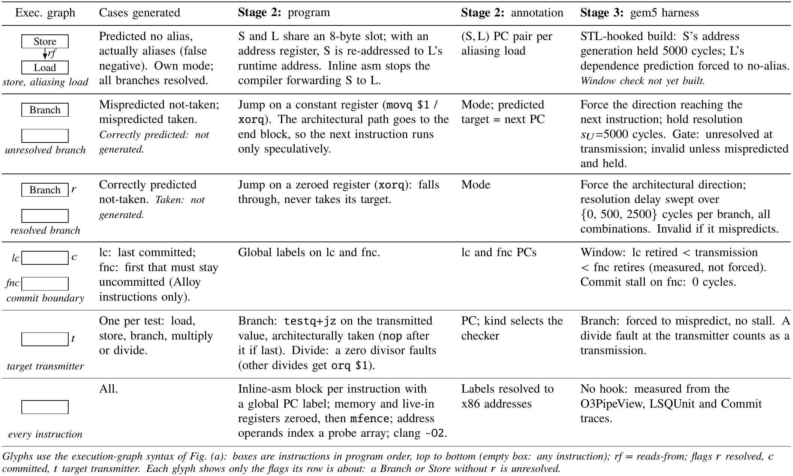
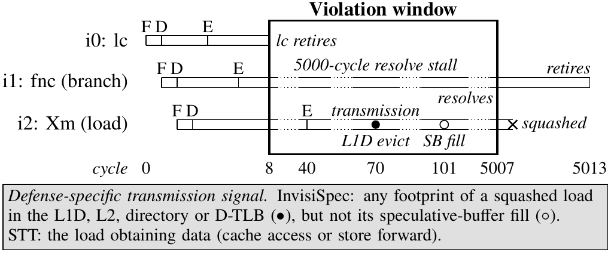

# Paper figures: all current drafts

One page with every draft. Sources (`_standalone_*.tex`) and previews (`*-1.png`) live in [`drafts/`](drafts/). Previews show the figure only, with blank space where the caption will go; the proposed captions are in the **Captions** section at the bottom, for Anna to edit and paste into each `\caption{}`. Plans, citations and open decisions per figure are in [`plans/`](plans/); the shared style is [`plans/VISUAL_LANGUAGE.md`](plans/VISUAL_LANGUAGE.md); the audit of every figure already in the paper is [`plans/AUDIT_existing_figures.md`](plans/AUDIT_existing_figures.md). Updated 2026-11-02.

## Which figure replaces what (proposal; Anna decides)

| Draft | Replaces in the paper (`test-paper`) | Status |
|---|---|---|
| Pipeline (vertical) | `tikz/threelayer.tex` (intro, Fig 1: wider than the column, 5pt text, never referenced) | draft; shape redesign in progress |
| (a) Execution-graph syntax | nothing (syntax is prose only at `sections/pipeline.tex:9`) | new |
| (b) Relaxation | `tikz/relaxation.tex` (Fig 3), and possibly `tikz/alloyviolation.tex` (Fig 2) if merged | draft |
| (c) Interleave | `tikz/interleave.tex` | draft; redraw as Stage 2 interleaving (decided) |
| (d) Instrumentation table | `tikz/sptable_v2.tex` / `sptable.tex` and `tikz/resolutiontiming_v2.tex` / `resolutiontiming.tex` | draft, full width |
| (e) Checker window | `tikz/checkerwindow.tex` | draft |
| (not redone yet) | `tikz/statetable.tex`, `tikz/squashrace.tex` (results) | keep; restyle per the audit |

## Pipeline (current: sources of truth on the left, 8pt body + 7pt notes)

Rejected earlier versions (no left column) are in `drafts/old/`. A shape-language redesign (how to make components meaningfully shaped instead of walls of text) is being drafted by an agent: `plans/BIGFIG_SHAPE_DESIGN.md` + `drafts/design_mocks/` when done; a fact audit of every label: `plans/BIGFIG_FACT_AUDIT.md` when done.

## (a) Execution-graph syntax

## (b) Relaxation

## (c) Interleave (pre-decision draft; will be redrawn as Stage 2 interleaving)

## (d) Instrumentation table (full width)

## (e) Checker window

## Captions (proposed; Anna edits and pastes into `\caption{}`)

**Pipeline.** The \toolname{} pipeline. Stage~1 uses Alloy to enumerate, up to a bound, minimal abstract execution graphs that satisfy a defense's leak definition, which is translated manually from the defense specification into the \toolname{} DSL. Stage~1.5 re-enumerates with loosened minimality, pinned to each Stage-1 graph, to reach more complex graphs. Stage~2 concretizes each graph into x86 programs with annotations, one per branch mode and interleave variant. Stage~3 runs each program on the defense's gem5 build under a harness that applies speculation and timing directives; an inspection program checks the pipeline trace for the defense's transmission criteria inside the speculative window. Gray marks defense-specific parts and sources of truth. *(Wording depends on fact-audit decisions D1–D2 in `plans/BIGFIG_FACT_AUDIT.md`: Stage 1.5 is a prototype, and "exhaustive" isn't supported yet, so this draft says "up to a bound".)*

**(a) Execution-graph syntax** (from `plans/fig_a_execgraphsyntax.md`; may become an inline code block instead). Execution graph syntax shared by every defense model. An execution is a graph on instructions: typed instruction nodes whose operands name register or memory state, Boolean annotations per instruction, and three relations. Bottom: the graph notation used in all later figures.

**(b) Relaxation** (from `plans/fig_b_relaxation.md`; will change with the notation redo). A violating STT execution from our enumeration (inst-047231), before minimization. Rows are in program order; solid and dashed arrows are rf and ddi edges. Black: the violation, a dependence path from $m_0$ (gray: in STT's protection set) through i3 to the address of transmitter i5, which is speculative because branch i2 is unresolved. Red: components whose removal (RI, RS) or flipping (RR) leaves the execution violating. Minimality removes them, leaving the three-instruction backbone i2, i3, i5.

**(c) Interleave.** To be rewritten with the Stage 2 redraw (decided: show Stage 2 interleaving and say so). The current paper caption names the wrong register (reg0 should be reg1; `plans/fig_c_interleave.md` M5).

**(d) Instrumentation table** (from `plans/fig_d_instrtable.md`; v2 in progress). How concretization instruments each execution-graph element. Stage 2 emits the program and its annotation; the Stage 3 harness reads the annotation to force predictions, hold resolutions, and bound the window in which the target transmitter must transmit. Values are those of the evaluated campaigns.

**(e) Checker window** (from `plans/fig_e_checkerwindow.md`; v4 in progress). Pipeline inspection of a real violation (InvisiSpec, STT_6 test inst-002014). Each bar is one instruction from fetch (F) to retire, with decode (D) and issue (E) marked; dotted stretches are elided cycles. The violation window opens when the last committed instruction (lc) retires and closes when the unresolved branch, here also the first non-committed instruction (fnc), resolves. Inside it, the transmitter evicts an L1D line, which InvisiSpec forbids, before it is squashed. Its fill of the speculative buffer is allowed. What counts as a transmission is defense-specific (shaded).
