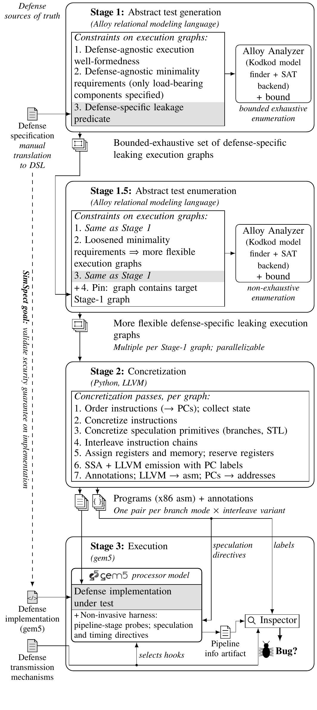
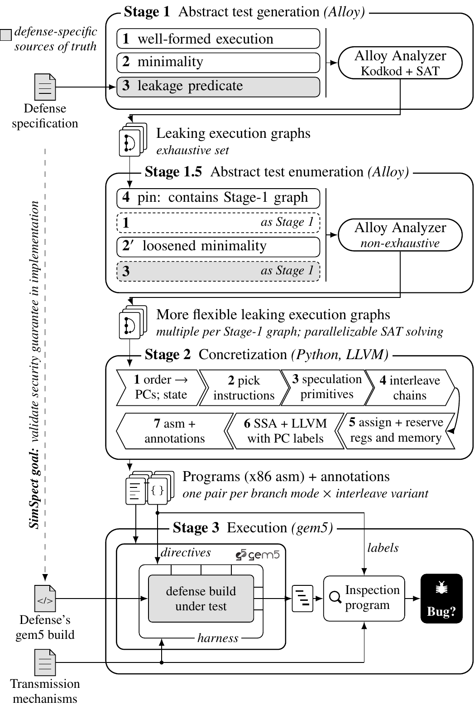
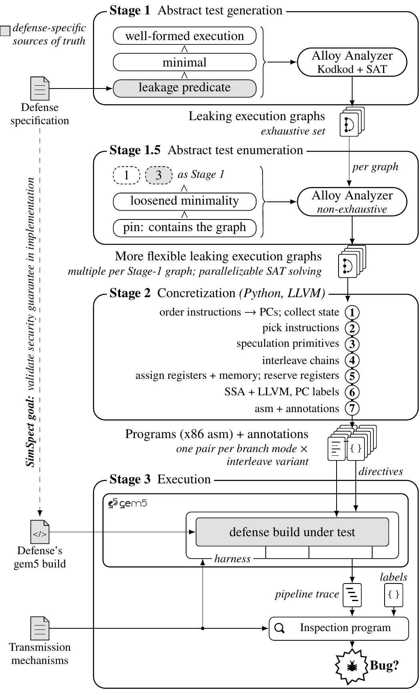
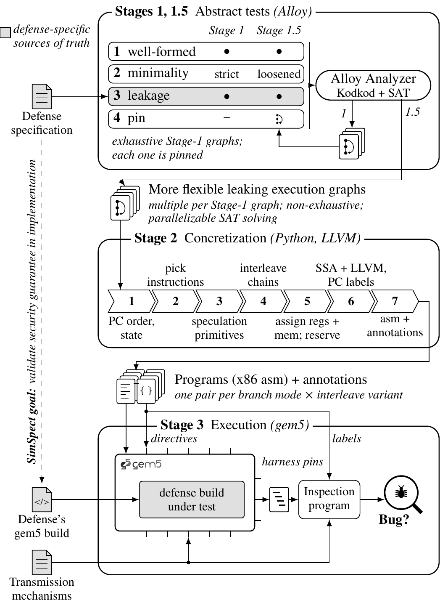
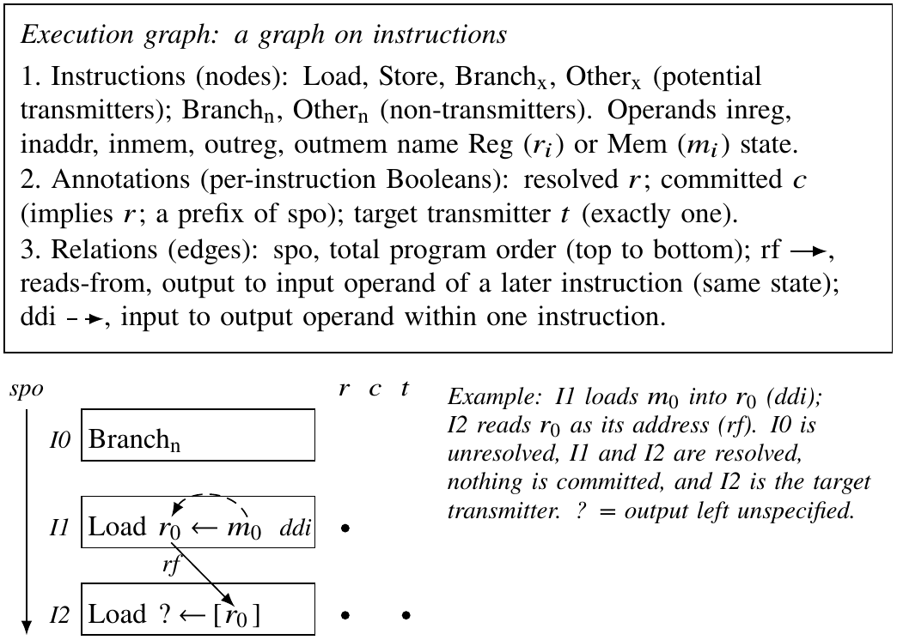
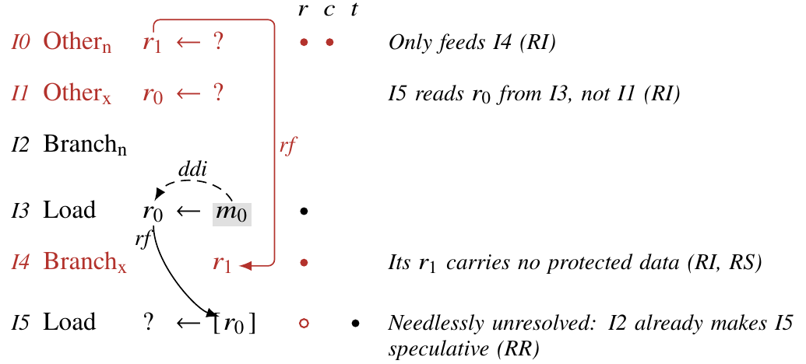
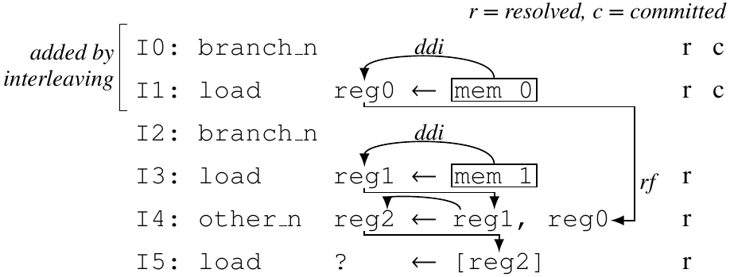
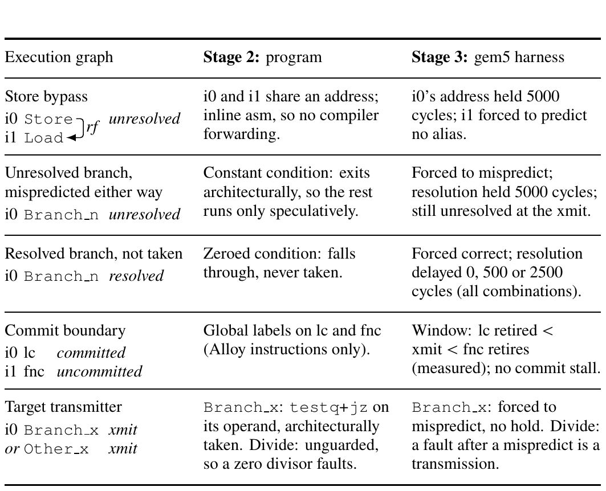
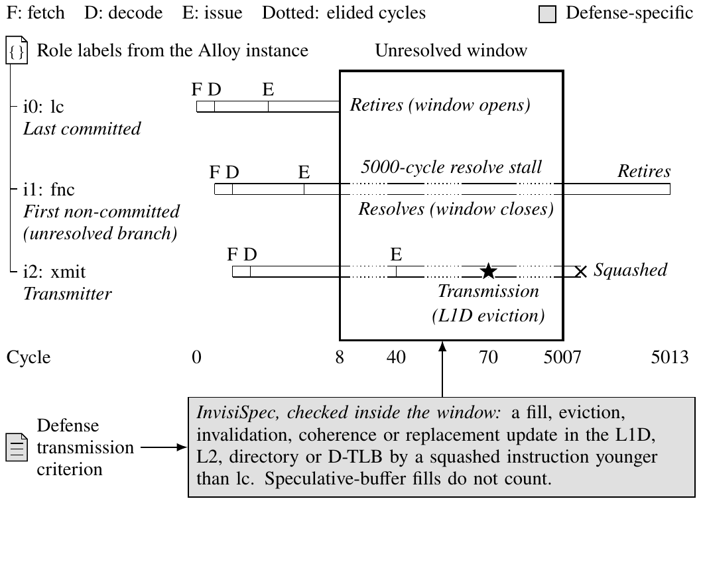
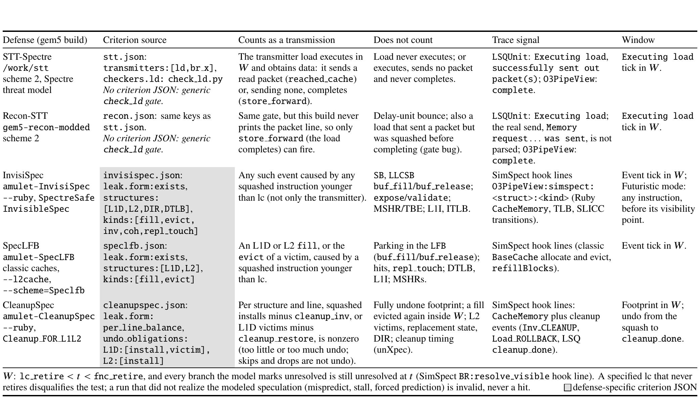

# Paper figures: all current drafts

One page with every draft. Sources (`_standalone_*.tex`) and previews (`*-1.png`) live in [`drafts/`](drafts/). Previews show the figure only, with blank space where the caption will go; the proposed captions are in the **Captions** section at the bottom, for Anna to edit and paste into each `\caption{}`. Plans, citations and open decisions per figure are in [`plans/`](plans/); the shared style is [`plans/VISUAL_LANGUAGE.md`](plans/VISUAL_LANGUAGE.md); the audit of every figure already in the paper is [`plans/AUDIT_existing_figures.md`](plans/AUDIT_existing_figures.md). Updated 2026-11-02.

## Which figure replaces what (proposal; Anna decides)

| Draft | Replaces in the paper (`test-paper`) | Status |
|---|---|---|
| Pipeline (vertical) | `tikz/threelayer.tex` (intro, Fig 1: wider than the column, 5pt text, never referenced) | draft; shape redesign in progress |
| (a) Execution-graph syntax | nothing (syntax is prose only at `sections/pipeline.tex:9`) | new |
| (b) Relaxation | `tikz/relaxation.tex` (Fig 3), and possibly `tikz/alloyviolation.tex` (Fig 2) if merged | draft |
| (c) Interleave | `tikz/interleave.tex` | draft; redraw as Stage 2 interleaving (decided) |
| (d) Instrumentation table | `tikz/sptable_v2.tex` / `sptable.tex` and `tikz/resolutiontiming_v2.tex` / `resolutiontiming.tex` | v2 draft, one column |
| (e) Checker window | `tikz/checkerwindow.tex` | v4 draft |
| (f) Transmission criteria | nothing (new) | draft, full width |
| (not redone yet) | `tikz/statetable.tex`, `tikz/squashrace.tex` (results) | keep; restyle per the audit |

## Pipeline (current: sources of truth on the left, 8pt body + 7pt notes)

Rejected earlier versions (no left column) are in `drafts/old/`. A shape-language redesign (how to make components meaningfully shaped instead of walls of text) is being drafted by an agent: `plans/BIGFIG_SHAPE_DESIGN.md` + `drafts/design_mocks/` when done; a fact audit of every label: `plans/BIGFIG_FACT_AUDIT.md` when done.

## Pipeline: shape-language redesign mocks (for comparison; Anna picks)

Brief and shape vocabulary: [`plans/BIGFIG_SHAPE_DESIGN.md`](plans/BIGFIG_SHAPE_DESIGN.md). The mocks predate the latest wording edits (e.g. "on implementation", "processor model", "parallelizable", the language lines), which carry over to whichever direction is chosen.

**A: shape-coded blobs** (agent's recommendation; 252 × 375 pt)

**B: one spine** (252 × 415 pt)

**C: merged Alloy stage** (252 × 345 pt)

## (a) Execution-graph syntax (OUTDATED: being redone as a vocab table)

## (b) Relaxation (OUTDATED: being redrawn in the shared notation)

## (c) Interleave (pre-decision draft; will be redrawn as Stage 2 interleaving)

## (d) Instrumentation table

v2: one column, 251 × 189 pt (v1, full width, is `drafts/_standalone_instrtable-1.png`).

## (e) Checker window

v4: 251 × 179 pt (v3 is `drafts/_standalone_checkerwindow_v3-1.png`).

## (f) Load-transmitter transmission criteria per defense (full width, new)

## Reference: how Caroline Trippel's papers draw these things

13 papers and 17 figure crops in [`reference_papers/crops/`](reference_papers/crops/); conventions with page cites in [`plans/TRIPPEL_FIGURE_STYLE.md`](plans/TRIPPEL_FIGURE_STYLE.md).

## Captions (proposed; Anna edits and pastes into `\caption{}`)

**Pipeline.** The \toolname{} pipeline. Stage~1 uses Alloy to enumerate, exhaustively up to a bound, minimal abstract execution graphs that satisfy a defense's leak definition, which is translated manually from the defense specification into the \toolname{} DSL. Stage~1.5 re-enumerates with loosened minimality, pinned to each Stage-1 graph, to reach more complex graphs. Stage~2 concretizes each graph into x86 programs with annotations, one per branch mode and interleave variant. Stage~3 runs each program on the defense's gem5 build under a harness that applies speculation and timing directives; an inspection program checks the pipeline trace for the defense's transmission criteria inside the speculative window. Gray marks defense-specific parts and sources of truth. *("Bounded exhaustive" holds once Stage 1 runs to completion at the bound; see `URGENT_TODO.md`.)*

**(a) Execution-graph syntax** (from `plans/fig_a_execgraphsyntax.md`; may become an inline code block instead). Execution graph syntax shared by every defense model. An execution is a graph on instructions: typed instruction nodes whose operands name register or memory state, Boolean annotations per instruction, and three relations. Bottom: the graph notation used in all later figures.

**(b) Relaxation** (from `plans/fig_b_relaxation.md`; will change with the notation redo). A violating STT execution from our enumeration (inst-047231), before minimization. Rows are in program order; solid and dashed arrows are rf and ddi edges. Black: the violation, a dependence path from $m_0$ (gray: in STT's protection set) through i3 to the address of transmitter i5, which is speculative because branch i2 is unresolved. Red: components whose removal (RI, RS) or flipping (RR) leaves the execution violating. Minimality removes them, leaving the three-instruction backbone i2, i3, i5.

**(c) Interleave.** To be rewritten with the Stage 2 redraw (decided: show Stage 2 interleaving and say so). The current paper caption names the wrong register (reg0 should be reg1; `plans/fig_c_interleave.md` M5).

**(d) Instrumentation table (v2).** \textbf{How concretization instruments each execution-graph element.} Rows are graph fragments in the notation of Fig.~X (xmit: the test's one target transmitter; lc, fnc: last committed, first non-committed). Stage~2 also annotates each element's PC, each branch's mode and predicted target, and the xmit's kind; Stage~3 uses the annotation and marks a run invalid if a force or hold did not take effect. Every instruction is an inline-asm block with a global PC label, after a prologue that zeroes state and runs \texttt{mfence}; no other instruction is hooked. Not generated: correctly predicted unresolved branches, taken resolved branches. *(Agent suggests moving the last two sentences into the text.)*

**(e) Checker window (v4).** \textbf{How the checker decides a violation, on a real gem5 trace} (InvisiSpec build, test inst-002014). Each bar is one instruction from fetch (F) through decode (D) and issue (E) to retirement; dotted stretches are elided cycles. The roles lc (last committed), fnc (first non-committed, here the unresolved branch) and xmit (transmitter) are labels carried from the Alloy instance, and the unresolved window runs from lc's retirement to the branch's resolution. Inside that window the checker applies the defense's transmission criterion (gray): xmit's L1D eviction ($\star$) meets InvisiSpec's criterion before xmit is squashed, so the test is reported as a violation.

**(f) Transmission criteria.** \textbf{Load-transmitter transmission criteria per defense.} For each defense build, what the Stage~3 inspection program counts as a load transmitting, what it deliberately ignores, and which trace line it reads. InvisiSpec, SpecLFB and CleanupSpec each have a defense-specific criterion (gray), stated over \toolname{}'s cache-event hook lines and scoped to the structures the defense's paper protects. STT-Spectre and Recon-STT have no such criterion and use the generic load gate.
