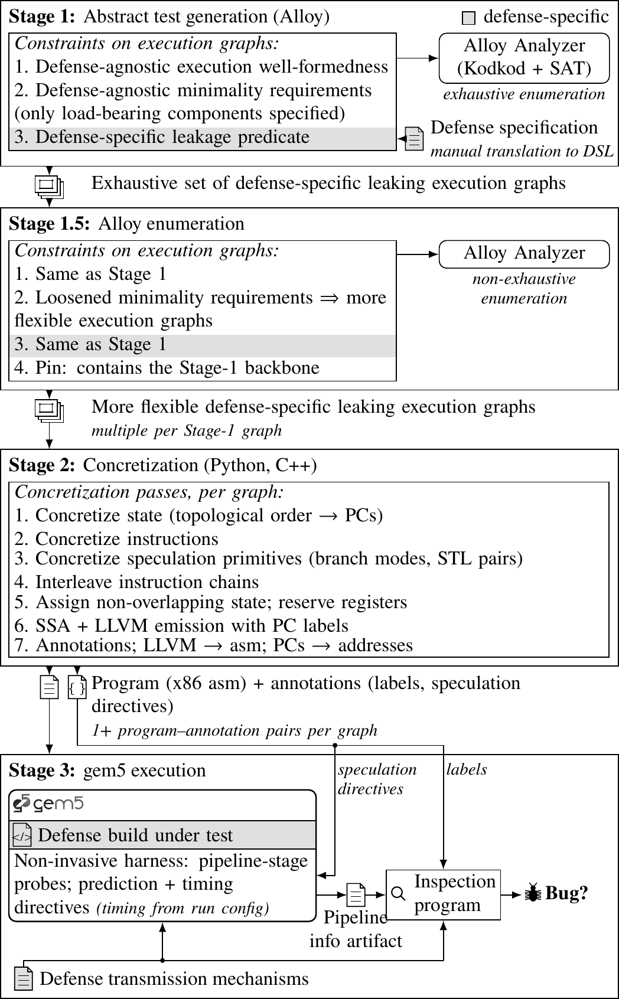

# Paper figures: all current drafts

One page with every draft. Sources (`_standalone_*.tex`) and previews (`*-1.png`) live in [`drafts/`](drafts/). Plans, citations and open decisions per figure are in [`plans/`](plans/); the shared style is [`plans/VISUAL_LANGUAGE.md`](plans/VISUAL_LANGUAGE.md); the audit of every figure already in the paper is [`plans/AUDIT_existing_figures.md`](plans/AUDIT_existing_figures.md). Updated 2026-11-02.

## Which figure replaces what (proposal; Anna decides)

| Draft | Replaces in the paper (`test-paper`) | Status |
|---|---|---|
| Pipeline (vertical) | `tikz/threelayer.tex` (intro, Fig 1: wider than the column, 5pt text, never referenced) | 7pt and 8pt versions below |
| (a) Execution-graph syntax | nothing (syntax is prose only at `sections/pipeline.tex:9`) | new |
| (b) Relaxation | `tikz/relaxation.tex` (Fig 3), and possibly `tikz/alloyviolation.tex` (Fig 2) if merged | draft |
| (c) Interleave | `tikz/interleave.tex` | draft; redraw as Stage 2 interleaving (decided) |
| (d) Instrumentation table | `tikz/sptable_v2.tex` / `sptable.tex` and `tikz/resolutiontiming_v2.tex` / `resolutiontiming.tex` | draft, full width |
| (e) Checker window | `tikz/checkerwindow.tex` | draft |
| (not redone yet) | `tikz/statetable.tex`, `tikz/squashrace.tex` (results) | keep; restyle per the audit |

## Pipeline, 7pt everywhere (252 × 366 pt)

## Pipeline, 8pt body + 7pt notes (252 × 406 pt)

## (a) Execution-graph syntax

## (b) Relaxation

## (c) Interleave (pre-decision draft; will be redrawn as Stage 2 interleaving)

## (d) Instrumentation table (full width)

## (e) Checker window

